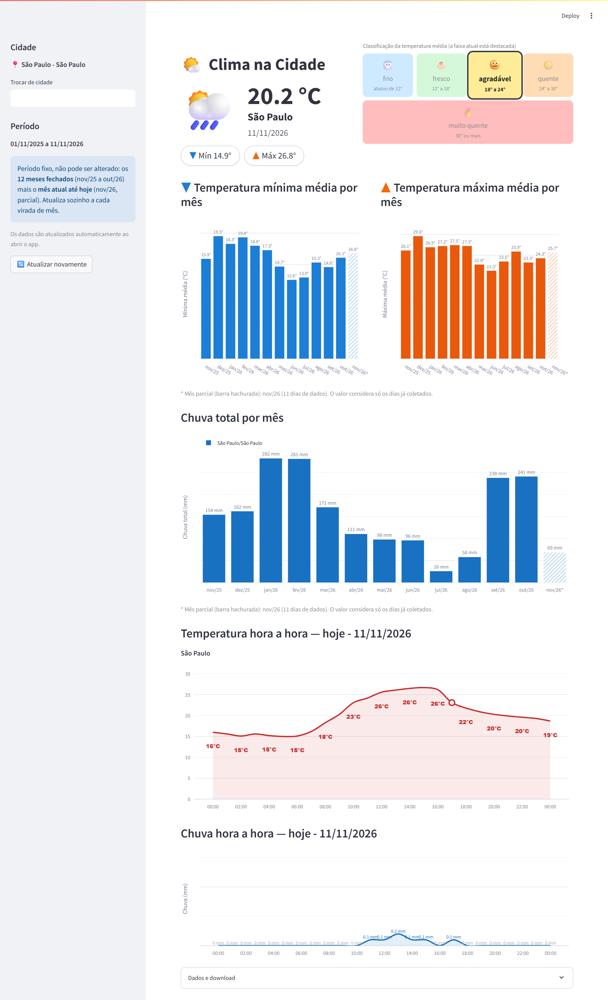

# 🌤️ Clima na Cidade

[](https://github.com/bussbruno/AppClimaCidades/actions/workflows/ci.yml)



Aplicativo em **Streamlit** que mostra o clima de uma cidade brasileira: temperatura atual, previsão hora a hora de hoje e o histórico dos últimos meses (temperatura mínima/máxima média e chuva por mês).

Os dados vêm da API gratuita [Open-Meteo](https://open-meteo.com) (não precisa de chave) e ficam guardados em um banco **SQLite** local, formando um histórico que cresce a cada uso.

## 📚 Sobre este projeto

Projeto de **estudo**, criado para praticar consumo de APIs REST, persistência com SQLite, organização de código em módulos, testes automatizados com pytest, CI no GitHub Actions e visualização de dados com Streamlit e Plotly. Não é um serviço oficial de previsão do tempo: para decisões que dependem do clima, consulte fontes como o [INMET](https://portal.inmet.gov.br).

## O que o app mostra

- **Cartão do dia:** temperatura média, cidade, data, máxima e mínima, com ícone do tempo.
- **Classificação da temperatura:** 🥶 frio · 🧥 fresco · 🙂 agradável · ☀️ quente · 🔥 muito quente, com a faixa atual destacada.
- **Temperatura mínima média por mês** e **temperatura máxima média por mês**.
- **Chuva total por mês** (em mm).
- **Temperatura hora a hora — hoje** e **Chuva hora a hora — hoje**.
- **Dados e download:** tabela com os dados diários e exportação em CSV.

### Regras do período

O período exibido é **fixo e automático**: os **12 meses fechados** anteriores mais o **mês atual até hoje**. Ele se ajusta sozinho a cada virada de mês. Não é possível filtrar o passado na tela.

O mês atual é **parcial**: aparece com asterisco (`nov/26*`) e barra hachurada, e o valor considera só os dias já coletados. Qualquer outro mês com dias faltando também é marcado assim.

### Atualização dos dados

Ao abrir o app, ele busca sozinho o que falta (histórico dos 12 meses e os últimos 7 dias). O botão **🔄 Atualizar novamente** força uma nova coleta. Sem internet, o app avisa e usa o que já está gravado.

## Como usar

### Requisitos

- Python 3.10 ou superior
- Acesso à internet (para consultar a Open-Meteo)

### Instalação

```bash
git clone https://github.com/bussbruno/AppClimaCidades.git
cd AppClimaCidades

python -m venv .venv
# Windows:
.venv\Scripts\activate
# Linux/macOS:
source .venv/bin/activate

pip install -r requirements.txt
```

### Executar o app

```bash
streamlit run app.py
```

O navegador abre em `http://localhost:8501`, com **São Paulo** como cidade padrão. Para trocar, digite o nome em **Trocar de cidade** na barra lateral e clique em **Usar esta cidade**. A primeira vez que uma cidade é escolhida leva um pouco mais, porque o histórico é baixado.

## Coleta pela linha de comando (opcional)

O app já se atualiza sozinho, mas o coletor serve para guardar histórico maior ou rodar de forma agendada.

```bash
# coleta dos últimos dias (padrão: São Paulo)
python coletor.py

# outra cidade (uma por vez, como no app)
python coletor.py --cidade "Curitiba"

# histórico de 5 anos
python coletor.py --backfill-dias 1825
```

- O histórico é baixado em **blocos de 1 ano**. Se um bloco falhar (a API às vezes responde com timeout ou erro 503), os outros continuam e o coletor avisa qual período faltou. Basta rodar de novo.
- A gravação é **idempotente** (por cidade e data): rodar várias vezes não duplica dados.
- Dados fora do período do app (mais de 12 meses) ficam no banco, mas não aparecem na tela.

### Agendamento diário (opcional)

Windows (Agendador de Tarefas):

```
schtasks /Create /SC DAILY /ST 07:00 /TN "ClimaColetor" /TR "cmd /c cd /d C:\caminho\AppClimaCidades && .venv\Scripts\python coletor.py --cidade \"São Paulo\""
```

Linux/macOS (cron):

```
0 7 * * * cd /caminho/AppClimaCidades && .venv/bin/python coletor.py --cidade "São Paulo"
```

## Estrutura do projeto

```
AppClimaCidades/
├─ app.py              # tela Streamlit (só monta a página)
├─ coletor.py          # coleta via linha de comando
├─ clima/
│  ├─ api.py           # clientes da Open-Meteo (busca de cidade, clima, previsão horária)
│  ├─ db.py            # banco SQLite (tabelas, gravação, consultas)
│  ├─ servico.py       # junta API e banco (coleta, backfill, período padrão)
│  ├─ analise.py       # médias/somas mensais, meses parciais e rótulos
│  ├─ graficos.py      # gráficos Plotly (funções puras, sem Streamlit)
│  └─ componentes.py   # HTML do cartão do dia e da classificação de temperatura
├─ tests/              # testes (pytest)
├─ data/clima.db       # banco local, criado automaticamente (não vai para o git)
└─ requirements.txt
```

### Banco de dados

SQLite em `data/clima.db`, com as tabelas `cidades` e `clima_diario` (temperaturas máx/mín/média, chuva e vento de cada dia).

## Testes

```bash
pytest
```

Os testes não acessam a internet (a API é simulada). A cada `push` e pull request, o GitHub Actions ([.github/workflows/ci.yml](.github/workflows/ci.yml)) roda a verificação de código (`pyflakes`), os testes e confirma que o app abre sem erros, em Python 3.10 e 3.12.

## Observações

- **Erro de certificado SSL** (comum em redes corporativas com proxy): o projeto usa o pacote `truststore`, que aproveita os certificados do sistema operacional. Ele já está no `requirements.txt`.
- **Previsão horária:** buscada a cada abertura do app e guardada por 15 minutos; não é gravada no banco.
- **Fuso horário:** os dados são pedidos em `America/Sao_Paulo`.

## Dados e créditos

Dados meteorológicos por [Open-Meteo.com](https://open-meteo.com), disponibilizados sob a licença [CC BY 4.0](https://creativecommons.org/licenses/by/4.0/). A API gratuita é para uso **não comercial**; veja os [termos de uso](https://open-meteo.com/en/terms) antes de uso comercial ou de alto volume.
